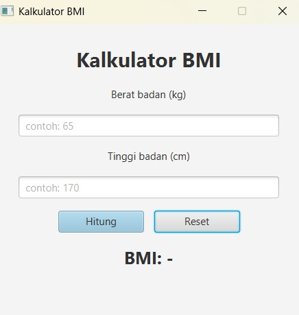
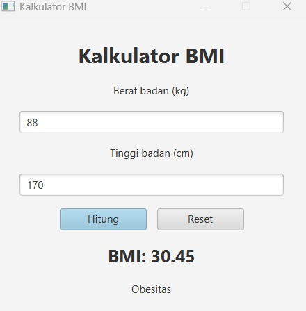

# Kalkulator BMI

Aplikasi sederhana penghitung Body Mass Index (BMI) dengan dua tampilan, CLI agar mudah Debugging tes Code

- **CLI** (terminal) - `com.bmi.cli.MainCLI`
- **GUI** (JavaFX + FXML / Scene Builder) - `com.bmi.gui.MainGUI`

## Rumus

BMI = berat (kg) / (tinggi (m))^2

| BMI         | Kategori             |
| ----------- | -------------------- |
| < 18,5      | Berat badan kurang   |
| 18,5 - 24,9 | Berat badan normal   |
| 25 - 29,9   | Berat badan berlebih |
| >= 30       | Obesitas             |

(Klasifikasi mengikuti standar WHO.)

## Rekomendasi Struktur Proyek

```
src/main/java/com/bmi/
  model/BMICalculator.java   # logika perhitungan
  cli/MainCLI.java           # tampilan terminal
  gui/MainGUI.java           # entry point JavaFX
  gui/BMIController.java     # controller FXML
src/main/resources/com/bmi/gui/bmi-view.fxml   # layout (Scene Builder)
```

## Cara Menjalankan

Prasyarat: JDK 17+ dan Maven.

CLI:

```
mvn compile
java -cp target/classes com.bmi.cli.MainCLI
```

GUI:

```
mvn javafx:run
```

(Jalankan pada terminal atau terminal IDE)

## Cara Mengedit Tampilan

Buka `bmi-view.fxml` dengan Scene Builder (klik kanan file > Open in Scene Builder).

## Tampilan Aplikasi GUI

### GUI (JavaFX)




